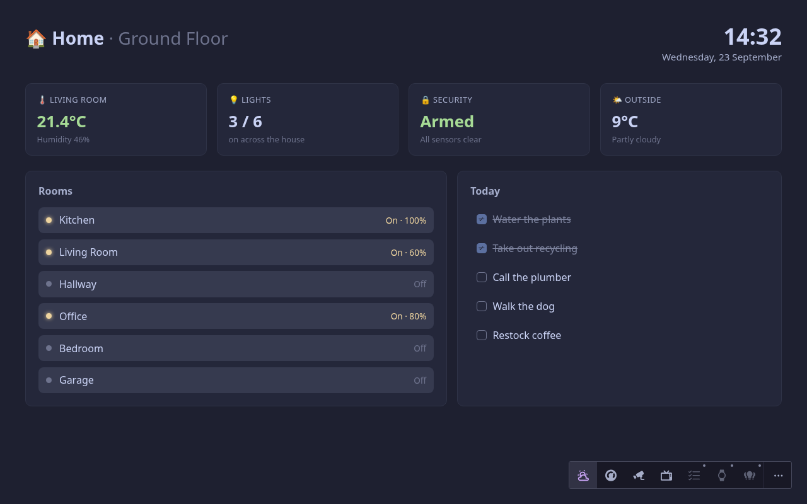
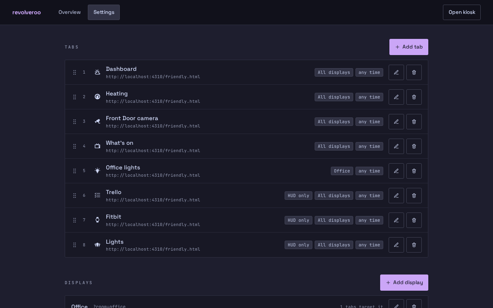

# Revolveroo

A self-hosted kiosk app that cycles through your internal dashboards on tablets, TVs, and wall monitors. Point it at Grafana, Home Assistant, Netdata, Uptime Kuma — anything running on your home lab or office network — and it rotates through them automatically in full-screen.

Revolveroo is built for a **house full of screens**, not just one: a single ordered tab registry drives every physical **Display**, and each tab declares which displays it plays on and in which time windows.

|                                                               |                                                                   |
| ------------------------------------------------------------- | ----------------------------------------------------------------- |
|  |  |

---

## Features

- **Auto-rotation** — dashboards cycle on a configurable interval with a progress hairline along the bottom of the screen
- **Displays** — name each physical screen (a tablet, a TV) and match it by a query param (`?room=office`) or by hostname; two browsers sharing the same match are treated as the same Display
- **Time windows** — restrict a tab to specific clock ranges (e.g. 9–5), with the days of the week chosen per tab so the same window can be reused differently across tabs
- **HUD-only tabs** — mark a tab to skip the autoplay loop but still reach it from the kiosk HUD
- **Custom per-tab duration** — override the global playback interval for an individual tab
- **Drag-to-reorder** — rearrange tabs in the settings UI without touching config files
- **Tab icons** — assign a Nerd Font glyph or emoji to each tab via a searchable picker (see [third-party attribution](apps/web/static/icons/THIRD_PARTY_LICENSES.md))
- **Configurable interval** — set playback speed from 1 s to 20 s with a slider
- **Color themes** — switch between Catppuccin (Mocha, Macchiato, Frappé, Latte), Rosé Pine (main, Dawn), Tokyo Night (Night, Day), Kanagawa (Wave, Lotus), Nord, and Dracula palettes, applied across the whole admin UI, not just the kiosk
- **Slimline / expanded HUD** — a compact strip when a display has a lot of tabs in its loop, a full glyph grid when it doesn't (or force either mode)
- **Overview** — a read-only `/overview` page showing which displays are online, what's currently on screen, and a tabs × displays grid of where everything lands
- **Health-aware autoplay** — a tab whose URL is failing is skipped automatically instead of showing a blank frame, with a failure card explaining what's wrong and what happens next
- **Optional per-tab reverse proxy** — a per-tab toggle routes a stubborn service's iframe through Revolveroo's own bundled Caddy proxy, which strips the `X-Frame-Options`/CSP headers refusing to be framed, instead of leaving "open in a new tab" as the only option. Proxied tabs can also inject request/response headers, cookies, query params and `localStorage` values (e.g. a one-click preset that keeps Home Assistant's sidebar hidden)

---

## Getting started

**Prerequisites:** [Docker](https://www.docker.com)

Versioned images are published to GHCR on every release, so there is no build step:

```bash
docker run -d --name revolveroo -p 80:80 -v revolveroo-data:/data ghcr.io/damianpokorski/revolveroo:latest
```

Or with Docker Compose:

```yaml
services:
  revolveroo:
    image: ghcr.io/damianpokorski/revolveroo:latest
    container_name: revolveroo
    ports:
      - "80:80"
    volumes:
      - revolveroo-data:/data
    restart: unless-stopped

volumes:
  revolveroo-data:
```

Then open `http://localhost`. A default data file is created in the `revolveroo-data` volume on first boot, seeded with example tabs to explore.

## Documentation

Guides, concepts and reference live on the docs site: **<https://damianpokorski.github.io/revolveroo/>**

- [Install with Docker](https://damianpokorski.github.io/revolveroo/getting-started/install/) and [set up your first kiosk](https://damianpokorski.github.io/revolveroo/getting-started/first-kiosk/)
- [HTTPS behind a reverse proxy](https://damianpokorski.github.io/revolveroo/getting-started/https-reverse-proxy/)
- [Embedding services that block iframing](https://damianpokorski.github.io/revolveroo/guides/embedding-blocked-services/)
- [Environment variables](https://damianpokorski.github.io/revolveroo/reference/environment-variables/), [data file schema](https://damianpokorski.github.io/revolveroo/reference/data-file-schema/) and [security model](https://damianpokorski.github.io/revolveroo/reference/security/)

Revolveroo's API has no login. It is meant for a trusted network, so read the security model before exposing it anywhere else.

---

## Contributing

For running from source, project structure, the full scripts table, end-to-end/visual-regression testing, architecture internals, and the tech stack, see [CONTRIBUTING.md](./CONTRIBUTING.md). For repo-specific SDLC conventions, see [CLAUDE.md](./CLAUDE.md).

## License

[MIT](./LICENSE)
